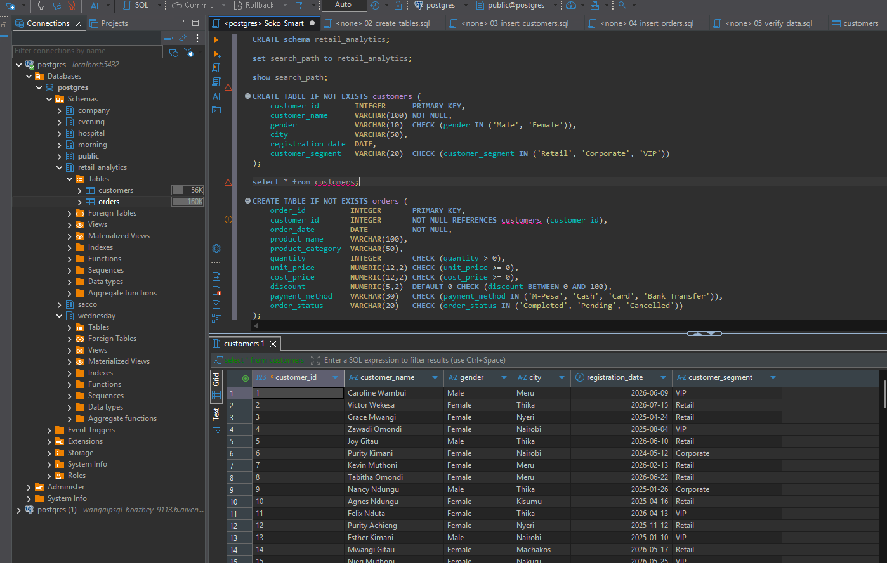
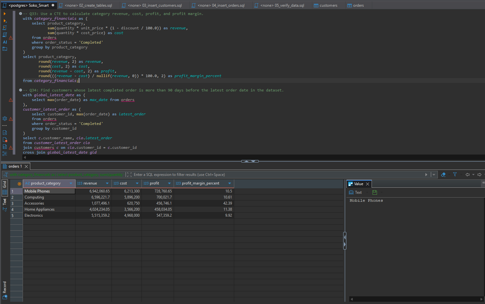

# Retail Sales & Customer Intelligence Analysis

An end-to-end SQL data analytics project analyzing sales performance, customer purchasing behavior, and product profitability for **Duka Smart Electronics**, a growing Kenyan electronics and appliances retailer.

This project uses PostgreSQL to build a relational database schema, load transactional data, and execute 46 analytical queries ranging from exploratory data analysis to advanced window functions, Common Table Expressions (CTEs), views, and PL/pgSQL stored functions.

---

## Repository Structure

```
├── schema.sql           # Schema definition (DDL), table constraints, and initial data population
├── queries.sql          # 46 numbered SQL queries answering business intelligence questions
├── insights.md          # Business insights, findings, and strategic recommendations
├── README.md            # Project overview, setup guide, and query execution manual
└── Screenshots/         # Query execution screenshots and schema verification outputs
```

---

## Dataset Overview

The database models retail operations across Kenya using two core entities:

1. **`customers`** (150 records)
   * Tracks customer demographic details, city locations (e.g., Nairobi, Mombasa, Kisumu, Nakuru, Eldoret), registration dates, and segment classifications (`Retail`, `Corporate`, `VIP`).

2. **`orders`** (800 records)
   * Contains line-item sales transactions spanning multiple categories (`Electronics`, `Mobile Phones`, `Computing`, `Home Appliances`, `Accessories`).
   * Tracks unit prices, cost prices, order quantities, discounts applied, payment methods (`M-Pesa`, `Cash`, `Card`, `Bank Transfer`), and order status (`Completed`, `Pending`, `Cancelled`).

---

## Analytical Scope

The 46 business questions in `queries.sql` cover four primary analytical tiers:

1. **Descriptive & Exploratory Analysis (Q1 – Q20):**
   * Record retrieval, demographic distribution across Kenyan cities, price spreads, payment method preferences (M-Pesa dominance), and cancellation rates.

2. **Relational Analysis & Customer Behavior (Q21 – Q30):**
   * Multi-table joins, lifetime value (LTV) calculations, cross-category purchasing habits, VIP customer preferences, and inactive customer detection.

3. **Advanced Aggregations & Financial Health (Q31 – Q42):**
   * CTE-based gross revenue and profit margin calculations across product categories.
   * Window functions (`RANK()`, `DENSE_RANK()`, `ROW_NUMBER()`, `NTILE(4)`) for customer spend segmentation and category rankings.
   * Time-series tracking: cumulative revenue running totals, lagged monthly sales, and Month-over-Month (MoM) revenue percentage growth rates.

4. **Database Objects & Executive Reporting (Q43 – Q46):**
   * Reusable views (`monthly_sales_summary`) aggregating monthly orders, revenue, cost, and net profit.
   * Stored PL/pgSQL function (`get_customer_revenue(p_customer_id)`) returning completed order revenue.
   * Customer value tier segmentation (`High`, `Medium`, `Low`).
   * Management reporting summarizing top-performing clients, flagship products, and category profit drivers.

---

## Sample Execution & Verification

Key milestones verified in DBeaver from the `Screenshots/` directory:

### 1. Database & Table Initialization
Validation of DDL schema execution and constraints:
<p align="center">
  
</p>

### 2. Multi-Table Joins & Customer Analytics
Executing relational queries linking customer profiles with transactional order records:
<p align="center">
  
</p>

### 3. Common Table Expressions (CTEs)
Structured modular queries analyzing multi-category spending and margin breakdowns:
<p align="center">
  
</p>

### 4. Advanced Window Functions & Ranking
Applying running totals, lagged month-over-month growth, and ranking metrics:
<p align="center">
  
</p>

---

## Setup & Installation

### Prerequisites
* [PostgreSQL](https://www.postgresql.org/download/) (v14 or higher recommended)
* [DBeaver Community Edition](https://dbeaver.io/) (or pgAdmin / `psql`)
* Git installed locally

### Step-by-Step Setup

1. **Clone the Repository**
   ```bash
   git clone https://github.com/SirWangai/SOKOSMART.git
   cd SOKOSMART
   ```

2. **Connect to PostgreSQL in DBeaver**
   * Open DBeaver and select **Database > New Database Connection**.
   * Choose **PostgreSQL** and supply your host, port, database name, username, and password.
   * Test the connection and click **Finish**.

3. **Initialize Schema & Load Data**
   * Open an SQL Editor session in DBeaver (`Ctrl + ]`).
   * Open `schema.sql` and execute the entire script (`Alt + X`).
   * This creates the `retail_analytics` schema, builds the `customers` and `orders` tables with referential integrity rules, and inserts the seed data.

4. **Verify Seed Counts**
   ```sql
   set search_path to retail_analytics;
   select count(*) from customers; -- Expected: 150
   select count(*) from orders;    -- Expected: 800
   ```

---

## Running the Analysis Queries

1. Open `queries.sql` in DBeaver.
2. Confirm the active search path is set:
   ```sql
   set search_path to retail_analytics;
   ```
3. **Run Individual Queries:** Place your cursor inside any query block (`-- QX:`) and press `Ctrl + Enter`.
4. **Run in Batches:** Highlight the target queries and press `Alt + X`.

---

## Technologies Used

* **Database Engine:** PostgreSQL
* **Client / Development Tool:** DBeaver Community Edition
* **Language / Dialect:** SQL (PostgreSQL, PL/pgSQL)
* **Version Control:** Git & GitHub

---

## Author

* **GitHub:** [@SirWangai](https://github.com/SirWangai)
* **Project Repository:** [SOKOSMART](https://github.com/SirWangai/SOKOSMART)